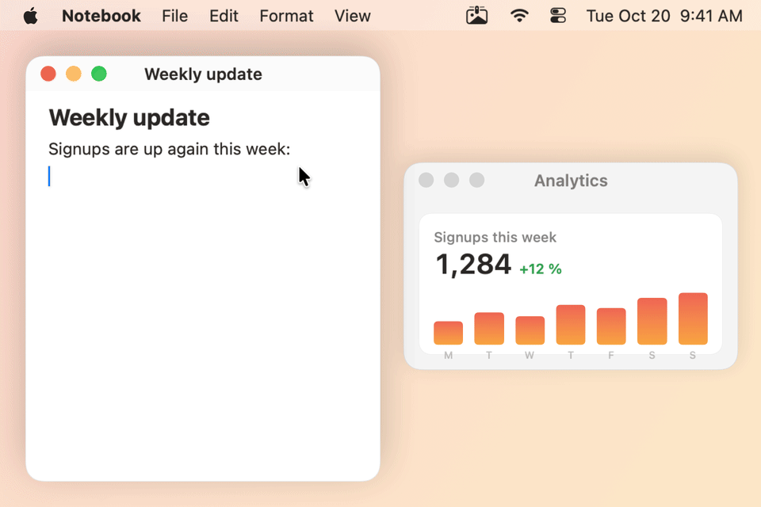
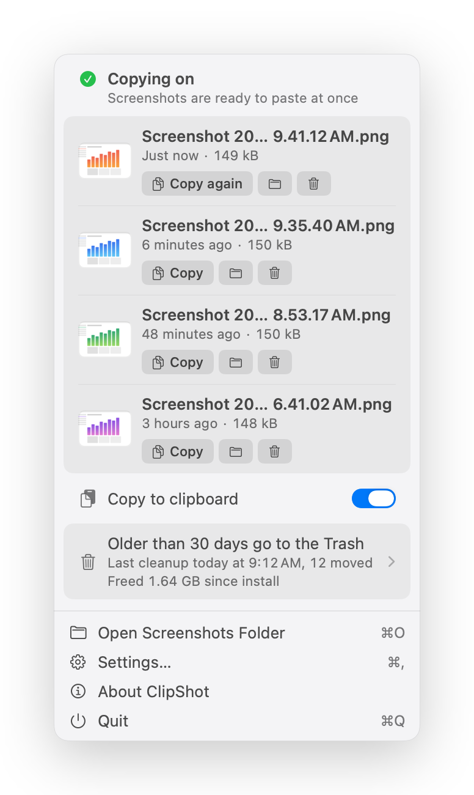
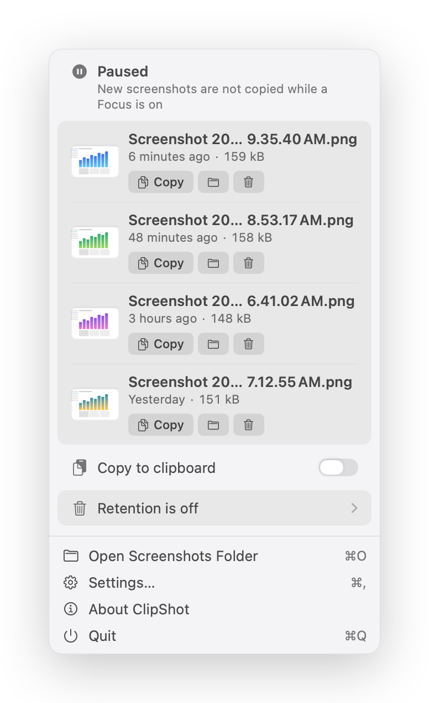

<p align="center"></p>

<h1 align="center">ClipShot</h1>

<p align="center"><strong>⇧⌘4, then just paste. The file is saved too.</strong></p>

<p align="center">
  <picture>
    <source media="(prefers-color-scheme: dark)" srcset="docs/hero-dark.gif">
    
  </picture>
</p>

<p align="center">
  
  
  <a href="LICENSE"></a>
</p>

ClipShot is a small macOS menu bar app that puts every screenshot on the clipboard
the moment you take it, and leaves the file where macOS saves it. It shows its own
floating preview, so you can mark the screenshot up, drag it somewhere or throw it
away, and it can move old screenshots to the Trash if you want it to.

```sh
brew install --cask m-moravcik/clipshot/clipshot
```

## Why this exists

macOS saves a screenshot as a file, or copies it to the clipboard if you hold
Control, but never both. And with the floating thumbnail on, the file only appears
once the thumbnail goes away, about six seconds later. I kept taking a screenshot,
switching to a chat and finding nothing to paste.

For a while a small script copied the newest screenshot to the clipboard for me. It
worked, but it waited for the thumbnail like everything else, and old screenshots
kept piling up. ClipShot is that script done properly.

## What it does

- **Copies every screenshot as you take it.** ⇧⌘3, ⇧⌘4 and ⇧⌘5 work as always;
  the image lands on the clipboard as soon as macOS saves the file, ready to paste
  with ⌘V. It goes on the clipboard as an image, so chat apps, Mail and browsers
  paste the picture, not a file attachment.
- **Keeps the file.** macOS still saves every screenshot to your screenshot folder.
- **Shows its own preview.** A small preview in the corner of the screen, like the
  macOS thumbnail but without holding the file back. Click it to mark the
  screenshot up, drag it into any app, or swipe it away.
- **Keeps the last few at hand.** The menu bar popover lists your four most recent
  screenshots, newest on top, each one click from Markup, Finder or the Trash.
- **Cleans up, if you ask it to.** Screenshots older than a period you choose go to
  the Trash. Off until you turn it on, and careful about what it touches (see
  [Retention and safety](#retention-and-safety)).
- **Changes the macOS screenshot settings for you.** The save folder and the
  preview, without Terminal, and with a way back to what you had before.
- **Shows what just happened in the menu bar.** Peg, the clothes peg icon, pegs up
  every copy, lets the picture drop when you move a screenshot to the Trash, grips it
  again on Undo and gives a little squeeze when you open the popover (see
  [Peg](#peg-the-menu-bar-icon)).
- **Works with Shortcuts and Focus.** Get, copy and clean up screenshots from the
  Shortcuts app, Siri or Spotlight, and pause copying while a Focus is on (see
  [Shortcuts](#shortcuts)).
- **Has a command line.** `clipshot latest` prints the path of the screenshot you just
  took, for scripts and coding agents; `clipshot pause` and friends go through the
  running app (see [Command line](#command-line)).

It works in English, Slovak, Czech, German, Spanish and French. A downloaded copy
updates itself; a Homebrew copy updates through [Homebrew](#homebrew).

## Install

### Homebrew

```sh
brew install --cask m-moravcik/clipshot/clipshot
```

Upgrade with `brew upgrade --cask m-moravcik/clipshot/clipshot`. A copy installed
by Homebrew leaves updates to Homebrew and does not update itself. The cask also
puts the `clipshot` command on your PATH.

### Manual

Download `ClipShot-<version>.zip` from the
[latest release](https://github.com/m-moravcik/ClipShot/releases/latest), unzip
it and move **ClipShot** to Applications. Releases are signed with Developer ID,
notarized and stapled, so it opens with a normal double-click. For the `clipshot`
command, click **Install…** in Settings > General; see [Command line](#command-line).

ClipShot requires macOS 26 or newer. It is a universal app, developed and tested
on Apple silicon; the Intel part ships for the Intel Macs that macOS 26 still
supports.

The first time you open it, a short tour in the popover explains what it does,
asks for access to your screenshot folder (macOS asks too if the folder is
Desktop, Documents or Downloads), lets you take a test screenshot, and offers
cleanup and launch at login.

## Using it

### Preview: ClipShot, macOS or None

While the macOS floating thumbnail is on screen, macOS keeps the screenshot in
memory and saves the file only when the thumbnail goes away. So a copy can be
instant, or it can wait for the thumbnail, but not both. Settings > Capture >
Preview picks one:

| Preview | What you see | When the copy lands |
|---|---|---|
| **ClipShot** (default) | ClipShot's own floating preview; the macOS thumbnail is off | at once |
| **macOS** | the macOS floating thumbnail | when the thumbnail goes away, about six seconds later |
| **None** | no preview at all | at once |

If you turn the thumbnail on yourself in ⇧⌘5 > Options, ClipShot follows and shows
**macOS**; it never turns it back off on its own.

<p align="center">
  <picture>
    <source media="(prefers-color-scheme: dark)" srcset="docs/screenshots/preview-hover-dark.png">
    
  </picture>
</p>

The preview stays for about five seconds, longer while the pointer is over it.
Several screenshots in a row stack up, three at most. On the preview:

- **Click** opens the screenshot in Markup; on hover a pencil says so.
- **Drag** it into any app to drop the file there.
- **Swipe** it to the right to dismiss it.
- **Hover** for Close, Copy again (once something else is on the clipboard) and
  Move to Trash. Right-click has the same, plus Edit with Markup and Show in Finder.

### Marking up

Click the preview, or any screenshot picture in the popover, and it opens in macOS
Markup. Draw, add text, crop, then click Done: ClipShot copies the edited image,
even if the edit took a while. If Markup is not available, the screenshot opens in
Preview instead.

### The popover

Click the menu bar icon. At the top, whether copying is on, anything that needs
fixing, and a downloaded update when one is ready. Below it, your four most recent
screenshots, newest on top, one row each and all alike: the picture (click it for
Markup, drag it into any app, or right-click for the menu), the name, how long ago
and the size, then Copy, Show in Finder and Move to Trash. The screenshot that is on
the clipboard now says Copy again. Then the Copy to clipboard switch, the cleanup
summary, and at the bottom Open Screenshots Folder, Settings, About and Quit.

<p align="center">
  <picture>
    <source media="(prefers-color-scheme: dark)" srcset="docs/screenshots/popover-dark.png">
    
  </picture>
</p>

### Peg, the menu bar icon

The icon is a clothes peg holding a picture on a line, and it moves only when
something happens:

- **A copy**: the old picture drops off, the new one slides in, the peg clamps it and
  a check shows for a moment.
- **Move to Trash**: the peg opens and the picture drops out of the menu bar; it comes
  back a moment later.
- **Undo**: the picture rises back into the open peg and is gripped again.
- **Opening the popover**: a short squeeze of the peg.

While copying is paused the picture has a dashed outline, and when something needs
fixing it hangs tilted with a "!". Cleanup's moves to the Trash play nothing. With
Reduce Motion on, Peg changes without moving.

### Move to Trash, and Undo

Move to Trash on the preview or on a row in the popover moves the file to the Trash,
with no dialog. Its row in the popover turns into **Moved to the Trash** with **Undo**,
which puts it back in the same place. Move several in a row and each keeps its own
strip and its own Undo; they all stay until five seconds after the last move, then the
rows below move up and older screenshots fill the list. ⌘Z puts back the last one
moved, and pressed again the one before. Moved from the floating preview, the preview
itself turns into **Moved to the Trash** with Undo too, so there is no need to open the
popover. If a move or an Undo cannot happen, ClipShot says why where you clicked.

<p align="center">
  <picture>
    <source media="(prefers-color-scheme: dark)" srcset="docs/screenshots/popover-undo-dark.png">
    
  </picture>
</p>

### Settings

- **General**: launch at login, copy to clipboard, replay the welcome tour, and
  whether the `clipshot` command is installed, with **Install…** when it is not.
  There is no copy sound: macOS's own shutter sound already confirms each
  screenshot, and the menu bar icon shows every copy.
- **Capture**: the folder macOS saves screenshots to, the preview, and Restore
  previous settings.
- **Retention**: cleanup (below).
- **About**: updates, version and links.

<p align="center">
  <picture>
    <source media="(prefers-color-scheme: dark)" srcset="docs/screenshots/settings-capture-dark.png">
    
  </picture>
</p>

## Retention and safety

Cleanup is off on a fresh install. Turn it on in Settings > Retention or in the
welcome tour, and pick a period: 7, 14, 30, 60 or 90 days, or your own. Before it
starts, you see how many screenshots, and how much space, would go to the Trash
right now.

<p align="center">
  <picture>
    <source media="(prefers-color-scheme: dark)" srcset="docs/screenshots/settings-retention-dark.png">
    
  </picture>
</p>

What it will and will not touch:

- **Only screenshots ClipShot saw being taken.** It keeps a list of the
  screenshots it saw being saved. Screenshots from before you installed it, or
  taken while it was not running, are left alone. Settings offers them
  separately, as "Also clean up N older screenshots", with their own count; they
  are added only when you click it.
- **A renamed screenshot is kept.** Rename one and cleanup leaves it alone from
  then on.
- **Only in the folder you confirmed.** If the screenshot folder changes, in
  ClipShot or in ⇧⌘5 > Options, cleanup pauses until you have looked at what it
  would move there. It refuses system folders, your home folder and the folders
  above it.
- **Only real screenshots.** A file counts when macOS marked it as a screenshot
  when it saved it, not by its name, which anyone can give a file. Downloaded
  files, screen recordings and files another user put into a shared folder are
  never touched, and never copied either.
- **Only to the Trash.** Nothing is ever deleted. On a volume without a Trash,
  cleanup turns itself off for that folder and tells you.

Cleanup runs at launch, every hour and after the Mac wakes, and moves at most 500
screenshots at a time. Age is counted from when the screenshot was taken.

Nothing leaves your Mac: ClipShot talks to the network only to check for updates.
Its log, `~/Library/Logs/clipshot.log`, records counts and file types, never file
names or paths.

## Shortcuts

ClipShot's actions are in the Shortcuts app under ClipShot, ready for your own
shortcuts and automations. Five of them have phrases for Siri and Spotlight,
translated into all six languages; Siri does not speak Slovak or Czech, so in those two
the phrases work in Spotlight and the Shortcuts app.

| Action | Parameters | What it does |
|---|---|---|
| **Get Latest Screenshot** | none | Gives the newest screenshot, as a file. |
| **Get Recent Screenshots** | Number of Screenshots, 1 to 10 (default 1) | Gives the newest screenshots, newest first, at most 512 MB at once; it says so when it had to stop short. |
| **Copy Latest Screenshot** | none | Copies the newest screenshot to the clipboard as an image, also while copying is paused. |
| **Pause Copying**, **Resume Copying** | none | The Copy to clipboard switch. |
| **Clean Up Old Screenshots Now** | Preview Only (default off) | Moves screenshots past your cleanup period to the Trash now and gives the number; with Preview Only it counts what would go and moves nothing. |

Some phrases: "Copy the latest screenshot with ClipShot", "Get my last screenshot
from ClipShot", "Pause ClipShot", "Resume ClipShot", "Clean up old screenshots with
ClipShot".

The screenshots are the ones the popover lists: those ClipShot saw being taken, in
your screenshot folder. Get hands over a copy of the file, not a path to it; for the
path, use [`clipshot latest`](#command-line). Clean Up is the cleanup from Settings
with all its checks (see [Retention and safety](#retention-and-safety)); it never
turns cleanup on, and unlike **Clean up now** in Settings it does not ask first, so
try it with Preview Only. Until the welcome tour is done, every action says "Finish
setting up ClipShot first" and does nothing. If ClipShot is not running, a shortcut
starts it, and it then runs as it does at login and stays in the menu bar.

### Pause copying during a Focus

In System Settings > Focus, pick a Focus, then under Focus Filters click **Add
Filter**, choose ClipShot, **Copying During Focus**, and switch on **Pause copying**.
The option starts off, so the filter does nothing until you switch it on.

While that Focus is on, new screenshots are still saved but not copied, and the
popover says why. When the Focus ends, copying resumes.

<p align="center">
  <picture>
    <source media="(prefers-color-scheme: dark)" srcset="docs/screenshots/popover-paused-focus-dark.png">
    
  </picture>
</p>

What to know:

- **Your own switch wins.** A pause you set yourself is never undone when the Focus
  ends, and if you resume copying while the Focus is on, it stays on until the Focus
  changes.
- **The popover says "a Focus", not which one.** macOS does not tell apps which Focus
  is on.
- **Two pausing Focuses in a row.** If you resumed copying by hand and then switch
  straight from one Focus with the filter to another with it, ClipShot may not see the
  switch, for the same reason, and copying stays on until a Focus ends.

## Command line

`clipshot` ships inside the app, at `ClipShot.app/Contents/Helpers/clipshot`, and is
always the app's version.

- **Homebrew**: the cask puts it on your PATH.
- **Downloaded ZIP**: open **Settings > General** and click **Install…** next to
  `clipshot`. It links `/usr/local/bin/clipshot` to the tool inside the app, after the
  standard macOS password prompt, and the link keeps working after updates. The row
  says where `clipshot` is once it is installed, and offers **Fix…** when an old link
  points to a ClipShot that was moved or deleted, or to another copy of it. The
  Homebrew cask's own link is never touched, and anything else named `clipshot` is
  left alone.

  Or make the link yourself (**Copy Command** next to Install copies this line with
  your app's path):

  ```sh
  sudo mkdir -p /usr/local/bin && sudo ln -s /Applications/ClipShot.app/Contents/Helpers/clipshot /usr/local/bin/clipshot
  ```

  On an Intel Mac, Homebrew links into `/usr/local/bin` too, so use either this link
  or the cask, not both.
- **From source**: `make install-cli PREFIX=~/.local` installs to `~/.local/bin`
  (put it on your PATH). Plain `make install-cli` installs to `/usr/local/bin`, which on
  Apple silicon is missing or root's until you run
  `sudo mkdir -p /usr/local/bin && sudo chown "$USER" /usr/local/bin`.

```text
clipshot [status] [--json]                 copying on or paused (and why), folder, cleanup, latest
clipshot latest [-n N] [--json]            newest screenshot paths, newest first (N 1-10)
clipshot copy [PATH | --latest] [--json]   copy a screenshot to the clipboard
clipshot pause | resume [--json]           switch copying off or on
clipshot clean [--dry-run] [--json]        move old screenshots to the Trash now
clipshot help [COMMAND] | --version
```

```sh
open "$(clipshot latest)"                  # the screenshot you just took, in Preview
clipshot latest -n 3                       # the three newest paths, one per line
clipshot copy ~/Desktop/Screenshot.png     # a screenshot ClipShot saw being taken, to the clipboard
clipshot pause && ./record-demo.sh && clipshot resume
clipshot clean --dry-run                   # what cleanup would move, moving nothing
```

`$(clipshot latest)` is the path of the newest screenshot, which makes it easy to hand
a screenshot to a script or a coding agent in the terminal: take the screenshot, then
`your-agent "Why does this dialog look wrong? $(clipshot latest)"`. Errors go to
stderr, so they never end up in place of the path.

`status` and `latest` read for themselves and work while ClipShot is not running.
If your screenshots go to Desktop, Documents or Downloads, macOS may ask once whether
your terminal app may read that folder.
Everything that changes something (`copy`, `pause`, `resume`, `clean`) goes through
the running app, over a socket only your user can open, and does exactly what the
popover and the Shortcuts actions do: the same image on the clipboard, Peg's copy
moment, cleanup's checks. `copy PATH` copies only a screenshot ClipShot saw being taken
(one the popover could list), directly in the screenshot folder; any other file there,
an image or a PDF included, is refused. Like the Shortcuts actions, every command but
`status` waits for the welcome tour.

Exit codes: `0` ok, `1` error, `2` usage, `3` ClipShot is not running (start it with
`open -a ClipShot`). With `--json`, output is JSON, and an error is
`{"error":{"code":...,"message":...}}` on stdout as well.

## Troubleshooting

### "macOS blocked access to Desktop"

If your screenshots go to Desktop, Documents or Downloads, macOS asks once whether
ClipShot may read that folder. If you clicked Don't Allow, the popover says so and
**Open Privacy Settings** takes you to Privacy & Security > Files & Folders, where
you can switch ClipShot on.

If the switch is missing or the prompt never comes back, reset the decision and
open ClipShot again:

```sh
tccutil reset SystemPolicyDesktopFolder sk.moravcik.ClipShot
```

Use `SystemPolicyDocumentsFolder` or `SystemPolicyDownloadsFolder` for those
folders.

### "Screenshots go to the clipboard only"

In ⇧⌘5 > Options, Save to can be set to Clipboard, or to an app such as Preview or
Mail. Then macOS saves no file and ClipShot has nothing to copy. The popover and
Settings > Capture show this with a **Save screenshots to a file** button that
sets it back.

### The copy takes about six seconds

Preview is set to **macOS**, so macOS saves the file only when its thumbnail goes
away. Click **Copy at once** in the popover, or pick **ClipShot** in Settings >
Capture.

### Coming from a copier script

If you used a script or a launchd agent that copies the newest screenshot to the
clipboard, turn it off before you start ClipShot, or two copiers race for every
screenshot. For a LaunchAgent:

```sh
launchctl bootout gui/$(id -u) ~/Library/LaunchAgents/<your-agent>.plist
```

Then move the plist and the script to the Trash.

## Uninstall

```sh
brew uninstall --cask --zap clipshot
```

`--zap` also removes ClipShot's settings, its list of screenshots and its log.
Your screenshots stay where they are.

The macOS screenshot settings ClipShot changed stay as they are too: the save
folder, and the floating thumbnail it turned off for its own preview. To put back
what you had before ClipShot, use **Settings > Capture > Restore previous
settings** before you uninstall.

Without Homebrew: quit ClipShot, move it to the Trash, and move these to the Trash
as well (the same list `--zap` uses), plus the `/usr/local/bin/clipshot` link if
you installed it:

- `~/Library/Application Support/ClipShot`
- `~/Library/Caches/sk.moravcik.ClipShot`
- `~/Library/HTTPStorages/sk.moravcik.ClipShot`
- `~/Library/Logs/clipshot.log` and `~/Library/Logs/clipshot.log.1`
- `~/Library/Preferences/sk.moravcik.ClipShot.plist` (or run
  `defaults delete sk.moravcik.ClipShot`)

## Building from source

```sh
brew install xcodegen
make app      # Release build, ad-hoc signed
make test     # unit tests
make l10n     # every string translated in all six languages
make guards   # static checks
```

`project.yml` is the source of truth; the Xcode project is generated and not
committed. A build you make yourself is ad-hoc signed, so it never updates itself,
and macOS asks for folder access again after each rebuild.

How it works inside, the screenshot harness, and releasing:
[DEVELOPMENT.md](DEVELOPMENT.md).

## Support

ClipShot is free and open source. If it saves you time, you can
[buy me a coffee](https://buymeacoffee.com/pexelo). It helps cover the Apple
Developer account that keeps releases signed and notarized.

## License

[MIT](LICENSE)

Built by [Michal Moravčík](https://github.com/m-moravcik). [More projects](https://web.pexelo.com/portfolio).
