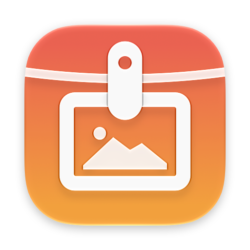
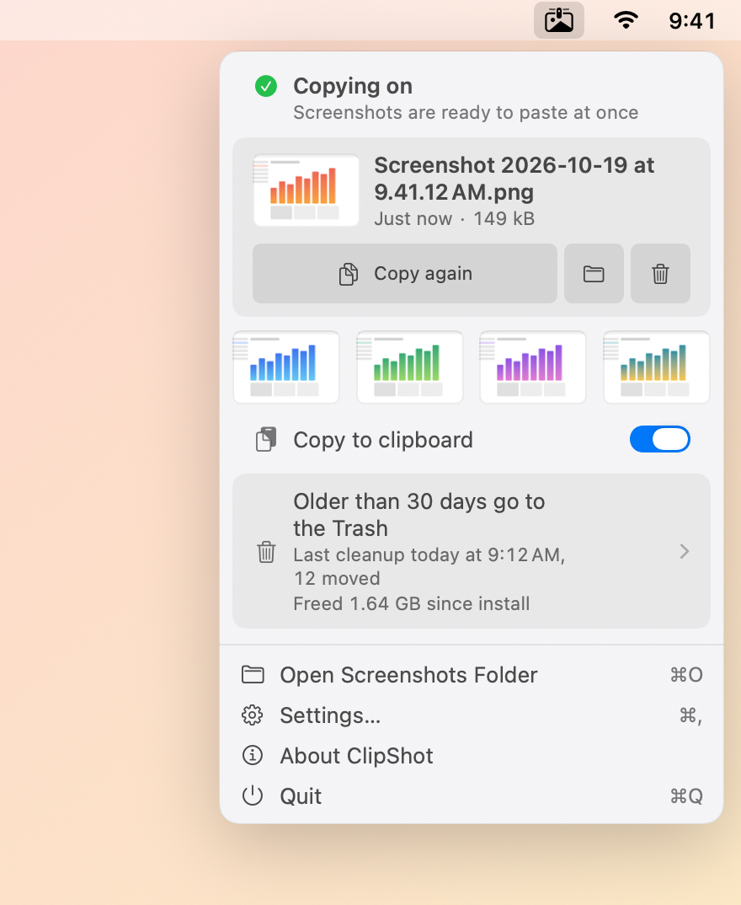
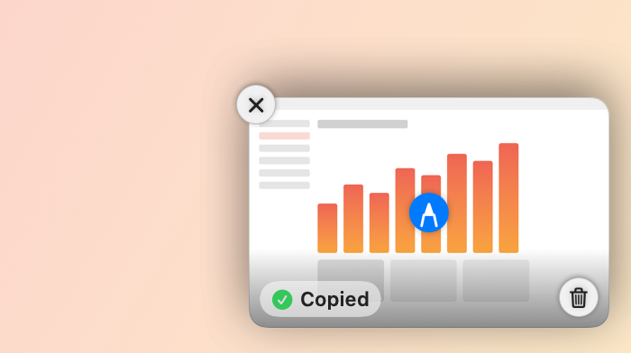
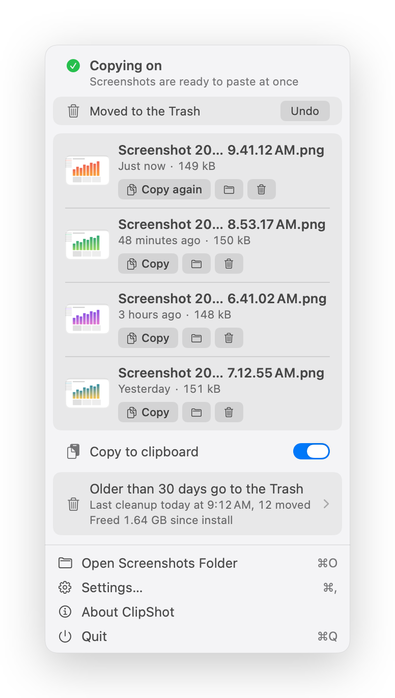
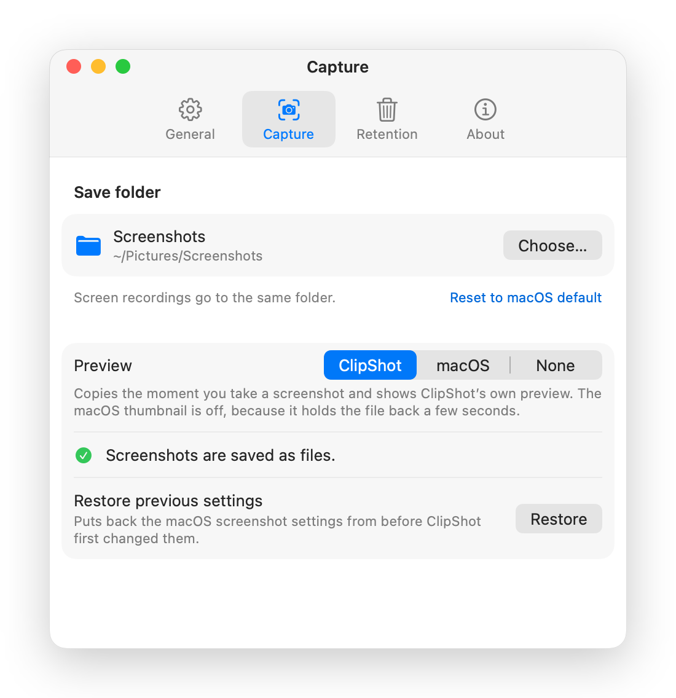
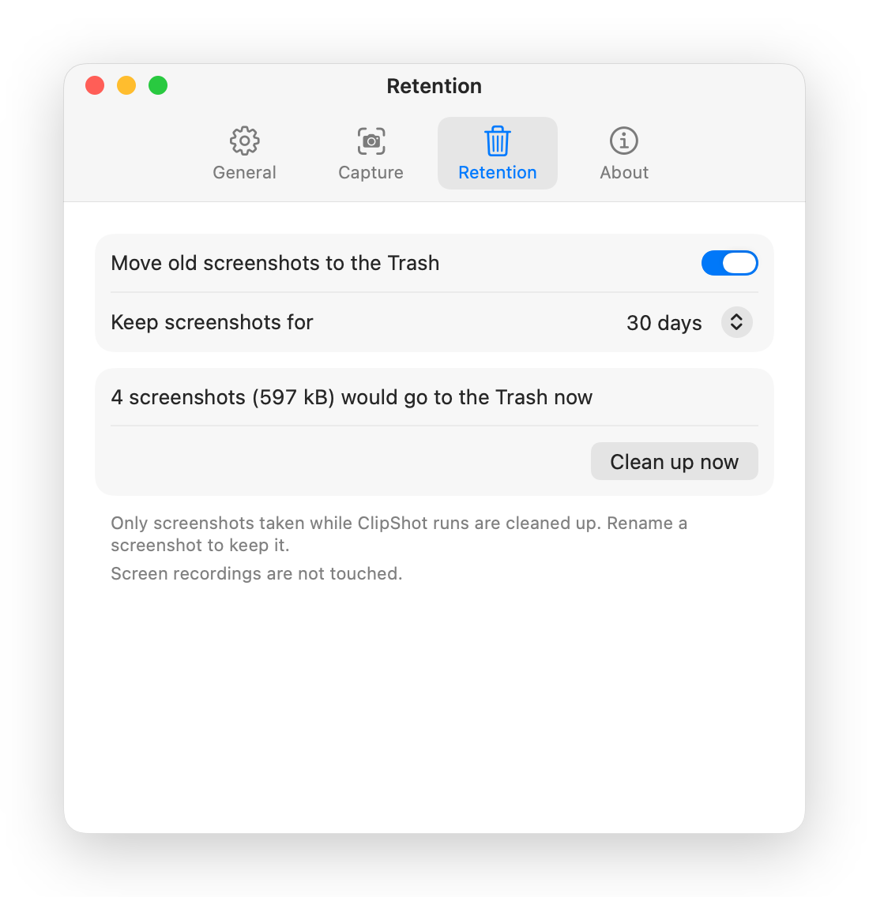

<p align="center"></p>

<h1 align="center">ClipShot</h1>

<p align="center"><strong>⇧⌘4, then just paste. The file is saved too.</strong></p>

ClipShot is a small macOS menu bar app that puts every screenshot on the clipboard
the moment you take it, and leaves the file where macOS saves it. It shows its own
floating preview, so you can mark the screenshot up, drag it somewhere or throw it
away, and it can move old screenshots to the Trash if you want it to.

<p align="center">
  <picture>
    <source media="(prefers-color-scheme: dark)" srcset="docs/screenshots/hero-dark.png">
    
  </picture>
</p>

```sh
brew install --cask m-moravcik/clipshot/clipshot
```

<!-- demo video: recorded with the owner -->

## Why this exists

macOS saves a screenshot as a file, or copies it to the clipboard if you hold
Control, but never both. And with the floating thumbnail on, the file only appears
once the thumbnail goes away, about six seconds later. I kept taking a screenshot,
switching to a chat and finding nothing to paste.

For a while a small script copied the newest screenshot to the clipboard for me. It
worked, but it waited for the thumbnail like everything else, and old screenshots
kept piling up. ClipShot is that script done properly.

## What it does

- **Copies every screenshot as you take it.** ⇧⌘3, ⇧⌘4 and ⇧⌘5 work as always;
  the image lands on the clipboard as soon as macOS saves the file, ready to paste
  with ⌘V. It goes on the clipboard as an image, so chat apps, Mail and browsers
  paste the picture, not a file attachment.
- **Keeps the file.** macOS still saves every screenshot to your screenshot folder.
- **Shows its own preview.** A small preview in the corner of the screen, like the
  macOS thumbnail but without holding the file back. Click it to mark the
  screenshot up, drag it into any app, or swipe it away.
- **Keeps the last few at hand.** The menu bar popover shows the latest screenshot
  and the four before it, each one click from Markup, Finder or the Trash.
- **Cleans up, if you ask it to.** Screenshots older than a period you choose go to
  the Trash. Off until you turn it on, and careful about what it touches (see
  [Retention and safety](#retention-and-safety)).
- **Changes the macOS screenshot settings for you.** The save folder and the
  preview, without Terminal, and with a way back to what you had before.

It works in English, Slovak, Czech, German, Spanish and French. A downloaded copy
updates itself; a Homebrew copy updates with `brew upgrade`.

## Install

### Homebrew

```sh
brew install --cask m-moravcik/clipshot/clipshot
```

Upgrade with `brew upgrade --cask clipshot`. A copy installed by Homebrew leaves
updates to Homebrew and does not update itself.

### Manual

Download `ClipShot-<version>.zip` from the
[latest release](https://github.com/m-moravcik/ClipShot/releases/latest), unzip
it and move **ClipShot** to Applications. Releases are signed with Developer ID,
notarized and stapled, so it opens with a normal double-click.

ClipShot requires macOS 26 or newer. It is a universal app, developed and tested
on Apple silicon; the Intel part ships for the Intel Macs that macOS 26 still
supports.

The first time you open it, a short tour in the popover explains what it does,
asks for access to your screenshot folder (macOS asks too if the folder is
Desktop, Documents or Downloads), lets you take a test screenshot, and offers
cleanup and launch at login.

## Using it

### Preview: ClipShot, macOS or None

While the macOS floating thumbnail is on screen, macOS keeps the screenshot in
memory and saves the file only when the thumbnail goes away. So a copy can be
instant, or it can wait for the thumbnail, but not both. Settings > Capture >
Preview picks one:

| Preview | What you see | When the copy lands |
|---|---|---|
| **ClipShot** (default) | ClipShot's own floating preview; the macOS thumbnail is off | at once |
| **macOS** | the macOS floating thumbnail | when the thumbnail goes away, about six seconds later |
| **None** | no preview at all | at once |

If you turn the thumbnail on yourself in ⇧⌘5 > Options, ClipShot follows and shows
**macOS**; it never turns it back off on its own.

<p align="center">
  <picture>
    <source media="(prefers-color-scheme: dark)" srcset="docs/screenshots/preview-hover-dark.png">
    
  </picture>
</p>

The preview stays for about five seconds, longer while the pointer is over it.
Several screenshots in a row stack up, three at most. On the preview:

- **Click** opens the screenshot in Markup.
- **Drag** it into any app to drop the file there.
- **Swipe** it to the right to dismiss it.
- **Hover** for Close, Copy again (once something else is on the clipboard) and
  Move to Trash. Right-click has the same, plus Edit with Markup and Show in Finder.

### Marking up

Click the preview, or any screenshot picture in the popover, and it opens in macOS
Markup. Draw, add text, crop, then click Done: ClipShot copies the edited image,
even if the edit took a while. If Markup is not available, the screenshot opens in
Preview instead.

### The popover

Click the menu bar icon. At the top, whether copying is on, and anything that
needs fixing. Below it, the latest screenshot with Copy again, Show in Finder and
Move to Trash, and a strip of the four screenshots before it, each with the same
Copy, Show in Finder and Move to Trash on hover (click one for Markup, right-click
for the menu, or drag one out). Then the Copy to clipboard
switch, the cleanup summary, and at the bottom Open Screenshots Folder, Settings,
About and Quit.

### Move to Trash, and Undo

Move to Trash on the preview, the latest screenshot or the strip moves the file to
the Trash, with no dialog. For five seconds the popover shows **Undo** (⌘Z), which
puts it back where it was.

<p align="center">
  <picture>
    <source media="(prefers-color-scheme: dark)" srcset="docs/screenshots/popover-undo-dark.png">
    
  </picture>
</p>

### Settings

- **General**: launch at login, copy to clipboard, a sound on each copy, and
  replay the welcome tour.
- **Capture**: the folder macOS saves screenshots to, the preview, and Restore
  previous settings.
- **Retention**: cleanup (below).
- **About**: updates, version and links.

<p align="center">
  <picture>
    <source media="(prefers-color-scheme: dark)" srcset="docs/screenshots/settings-capture-dark.png">
    
  </picture>
</p>

## Retention and safety

Cleanup is off on a fresh install. Turn it on in Settings > Retention or in the
welcome tour, and pick a period: 7, 14, 30, 60 or 90 days, or your own. Before it
starts, you see how many screenshots, and how much space, would go to the Trash
right now.

<p align="center">
  <picture>
    <source media="(prefers-color-scheme: dark)" srcset="docs/screenshots/settings-retention-dark.png">
    
  </picture>
</p>

What it will and will not touch:

- **Only screenshots ClipShot saw being taken.** It keeps a list of the
  screenshots it saw being saved. Screenshots from before you installed it, or
  taken while it was not running, are left alone. Settings offers them
  separately, as "Also clean up N older screenshots", with their own count; they
  are added only when you click it.
- **A renamed screenshot is kept.** Rename one and cleanup leaves it alone from
  then on.
- **Only in the folder you confirmed.** If the screenshot folder changes, in
  ClipShot or in ⇧⌘5 > Options, cleanup pauses until you have looked at what it
  would move there. It refuses system folders, your home folder and the folders
  above it.
- **Only real screenshots.** A file counts when macOS marked it as a screenshot
  when it saved it, not by its name, which anyone can give a file. Downloaded
  files, screen recordings and files another user put into a shared folder are
  never touched, and never copied either.
- **Only to the Trash.** Nothing is ever deleted. On a volume without a Trash,
  cleanup turns itself off for that folder and tells you.

Cleanup runs at launch, every hour and after the Mac wakes, and moves at most 500
screenshots at a time. Age is counted from when the screenshot was taken.

Nothing leaves your Mac: ClipShot talks to the network only to check for updates.
Its log, `~/Library/Logs/clipshot.log`, records counts and file types, never file
names or paths.

## Troubleshooting

### "macOS blocked access to Desktop"

If your screenshots go to Desktop, Documents or Downloads, macOS asks once whether
ClipShot may read that folder. If you clicked Don't Allow, the popover says so and
**Open Privacy Settings** takes you to Privacy & Security > Files & Folders, where
you can switch ClipShot on.

If the switch is missing or the prompt never comes back, reset the decision and
open ClipShot again:

```sh
tccutil reset SystemPolicyDesktopFolder sk.moravcik.ClipShot
```

Use `SystemPolicyDocumentsFolder` or `SystemPolicyDownloadsFolder` for those
folders.

### "Screenshots go to the clipboard only"

In ⇧⌘5 > Options, Save to can be set to Clipboard, or to an app such as Preview or
Mail. Then macOS saves no file and ClipShot has nothing to copy. The popover and
Settings > Capture show this with a **Save screenshots to a file** button that
sets it back.

### The copy takes about six seconds

Preview is set to **macOS**, so macOS saves the file only when its thumbnail goes
away. Click **Copy at once** in the popover, or pick **ClipShot** in Settings >
Capture.

### Coming from a copier script

If you used a script or a launchd agent that copies the newest screenshot to the
clipboard, turn it off before you start ClipShot, or two copiers race for every
screenshot. For a LaunchAgent:

```sh
launchctl bootout gui/$(id -u) ~/Library/LaunchAgents/<your-agent>.plist
```

Then move the plist and the script to the Trash.

## Uninstall

```sh
brew uninstall --cask --zap clipshot
```

`--zap` also removes ClipShot's settings, its list of screenshots and its log.
Your screenshots stay where they are.

The macOS screenshot settings ClipShot changed stay as they are too: the save
folder, and the floating thumbnail it turned off for its own preview. To put back
what you had before ClipShot, use **Settings > Capture > Restore previous
settings** before you uninstall.

Without Homebrew: quit ClipShot, move it to the Trash, and move these to the Trash
as well (the same list `--zap` uses):

- `~/Library/Application Support/ClipShot`
- `~/Library/Caches/sk.moravcik.ClipShot`
- `~/Library/HTTPStorages/sk.moravcik.ClipShot`
- `~/Library/Logs/clipshot.log` and `~/Library/Logs/clipshot.log.1`
- `~/Library/Preferences/sk.moravcik.ClipShot.plist` (or run
  `defaults delete sk.moravcik.ClipShot`)

## Building from source

```sh
brew install xcodegen
make app      # Release build, ad-hoc signed
make test     # unit tests
make l10n     # every string translated in all six languages
make guards   # static checks
```

`project.yml` is the source of truth; the Xcode project is generated and not
committed. A build you make yourself is ad-hoc signed, so it never updates itself,
and macOS asks for folder access again after each rebuild.

How it works inside, the screenshot harness, and releasing:
[DEVELOPMENT.md](DEVELOPMENT.md).

## Support

ClipShot is free and open source. If it saves you time, you can
[buy me a coffee](https://buymeacoffee.com/pexelo). It helps cover the Apple
Developer account that keeps releases signed and notarized.

## License

[MIT](LICENSE)

Built by [Michal Moravčík](https://github.com/m-moravcik). [More projects](https://web.pexelo.com/portfolio).
